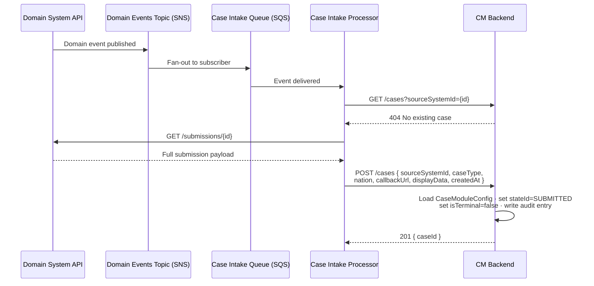

# waste-case-intake-processor

The Case Intake Processor (CIP) takes submission events from domain systems and turns them into cases in Case Management.

It is not regulator-specific. A single intake service serves all domains, and each domain has its own intake logic.

> **Status:** this repository is currently the CDP .NET backend template with build tooling, health check and
> README updates. The intake logic described below is not implemented yet.

- [How it works](#how-it-works)
- [Local development](#local-development)
- [Testing](#testing)
- [Formatting](#formatting)
- [Health check](#health-check)
- [Dependabot](#dependabot)
- [SonarCloud](#sonarcloud)
- [Licence](#licence)

## How it works

The example below shows a submission that creates a new case.



1. A domain system publishes an event when a submission is made or changes. The event reaches CIP through the case
   intake queue.
2. CIP asks Case Management whether there is already an open case for the submission.
3. CIP fetches the submission data from the domain system.
4. If there is no open case, CIP creates one in Case Management; otherwise it updates the existing case. Domain systems
   never call Case Management directly.

Because the queue sits in between, a domain system doesn't need Case Management to be available when it publishes an
event.

Whether each domain's intake logic is deployed as a separate service or combined into one deployable is still to be
decided.

## Local development

### Prerequisites

- .NET SDK 10
- Docker

### Docker Compose

[compose.yml](compose.yml) starts a local environment with:

- [floci](https://floci.io) for AWS services (S3, SQS, SNS)
- Redis
- MongoDB
- This service

```bash
docker compose up --build -d
```

A more extensive setup is available in [DEFRA/cdp-local-environment](https://github.com/DEFRA/cdp-local-environment).

### Running

```bash
dotnet run --project WasteCaseIntakeProcessor --launch-profile WasteCaseIntakeProcessor
```

### MongoDB

The template includes MongoDB. Locally it is started by Docker Compose (`docker compose up -d mongodb`). In CDP
environments the credentials are provided as environment variables, and you can use the CDP Terminal to inspect the
database.

## Testing

```bash
dotnet test
```

Tests run the full `WebApplication` in memory using `WebApplicationFactory`.

The build treats warnings as errors and runs the [SonarAnalyzer](https://www.nuget.org/packages/SonarAnalyzer.CSharp)
rules (see [Directory.Build.props](Directory.Build.props)), so analyzer findings fail the build.

## Formatting

Code is formatted with [CSharpier](https://csharpier.com/), installed as a local .NET tool. The pull request
workflow fails if any file is not formatted.

```bash
dotnet tool restore
dotnet csharpier format .   # format all files
dotnet csharpier check .    # check formatting, as CI does
```

## Health check

`GET /health` returns `200 OK` with the body `Healthy`. CDP uses this endpoint to check that the service is running.

## Dependabot

Dependabot is enabled in [.github/dependabot.yml](.github/dependabot.yml). Every Monday it checks the direct NuGet
dependencies and the GitHub Actions versions, with test dependencies grouped into a single pull request.

## SonarCloud

The SonarCloud scan is set up in [.github/workflows/sonarcloud.yml](.github/workflows/sonarcloud.yml) but not yet
enabled. To enable it, set up the project in SonarCloud, add the `SONAR_TOKEN` repository secret and uncomment the
`sonarcloud-scan` job in the pull request and publish workflows.

## Licence

The Open Government Licence (OGL) was developed by the Controller of Her Majesty's Stationery Office (HMSO) to enable
information providers in the public sector to license the use and re-use of their information under a common open
licence.

It is designed to encourage use and re-use of information freely and flexibly, with only a few conditions.
